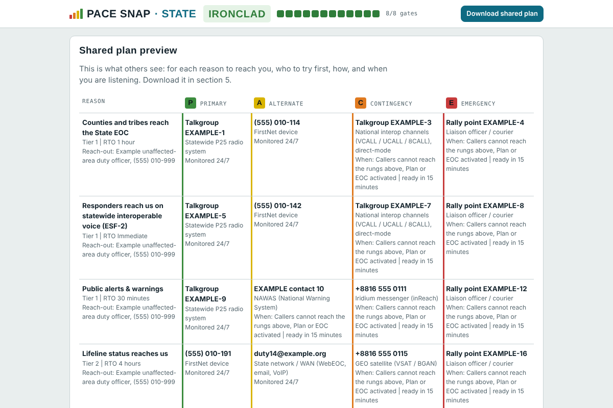

# PACE Snap

Build a PACE communications plan that tells other people **how to reach you**, in what order to try, and **when you are listening**. It runs in your browser, needs no account, and keeps your data on your device.

**Try it:** https://jdlee77.github.io/pacesnap_corperate/



## What it is

PACE (Primary, Alternate, Contingency, Emergency) is a method for deciding in advance what you will switch to when a communications path fails. PACE Snap turns that into a quick planning tool for five levels:

| Tier | For |
| --- | --- |
| Personal | One person (a SWIC, COML, duty officer) |
| Unit | A strike team, COMU, or EOC section |
| Agency | An emergency management director or comms manager |
| State | A SWIC or ESF-2 lead |
| Region | A multi-state group, such as a RECCWG |

The shared plan is about **inbound contact**: how counties, partners, responders and leadership get hold of you, and whether anyone is actually monitoring each method when they try.

## Guided setup

First-time visitors get an 11-step guided setup that teaches the method while building their own **Personal PACE plan**: the PACE idea, reasons people need to reach you, your kit, rating your gear on the four checks, your ladder, contacts, when you are listening, backup methods, a readiness check, and sharing. Answers save as you go, and **Guided setup** resumes where you left off.

## How it works

1. **Reasons to reach you.** Keep or edit the functions people need you for. Each gets its own ladder.
2. **Your kit.** Check only the gear you really have. It always starts empty. You can add your own items to any module.
3. **The plan builds itself.** Each function gets a P-A-C-E ladder on four distinct failure paths, with a plain-language reason for every rung. You can override any rung.
4. **Contacts and listening.** Add how others reach you, who answers, and when you monitor each method: always, business hours, on a schedule, or once the rungs above fail or the plan is activated.
5. **Drills and gates.** Outage drills show where the plan breaks. Readiness gates check Feasible, Acceptable, Suitable, Distinguishable and Complete (the CISA criteria), plus Monitored, and survival of every drill.
6. **Share.** Download a one-page-per-function PDF, or a CSV, or save your work to a file.

Extra carriers and spare methods go under **Backup methods**, so the ladders stay clean.

## Features

- Five tiers, each with its own functions, scenarios, weights and example assets
- Auto-built ladders, with a "why this rung" explanation for each
- Every method rated on Power, Availability, Compatibility and Ease of use
- Monitoring status and start-up conditions for every contact, written to be all-hazards
- Shared plan PDF (single plan or every plan in one file) and a separate planning report
- CSV export for compiling plans across organizations. Contact details are left out unless you tick the box.
- Save progress to a file and load it later, or on another device
- Guided setup that builds your Personal plan as you learn the tool, and a **Load sample plan** button to see a finished plan
- Light and dark themes, works on a phone, no tracking

## Privacy

Everything is stored in your browser's local storage. There is no server and no analytics. Exports can contain contact details, so share them with care. The CSV omits contact numbers, names and reach-out points by default.

## Run it locally

It is a single HTML file with no build step.

```
git clone https://github.com/jdlee77/pacesnap_corperate
cd pacesnap_corperate
python3 -m http.server 8000
```

Then open http://localhost:8000. You can also open `index.html` directly.

The first PDF export loads jsPDF and jsPDF-AutoTable from cdnjs, and the page loads its fonts from Google Fonts, so it needs internet at least once.

## Using the exports

- **Download shared plan** gives the PDF to hand to other people.
- **Planning report** adds the drills, gates and reasoning for your own files.
- **Export CSV** writes one row per rung (schema `pace-snap-csv-1`) so plans can be combined in a spreadsheet.
- **Save progress** writes a `.json` file with all five tiers. **Load progress** restores it.

Downloads need the page to be served normally. They do not work inside some embedded previews.

## Limits and assumptions

- The asset ratings, failure paths, outage scenarios and default monitoring conditions are the author's working assumptions. They need review by practitioners before anyone relies on them.
- PACE Snap checks a plan on paper. It does not replace testing: make a real two-way contact on each rung.
- This is an independent project. It is not an official NCSWIC, CISA or FEMA product.

## Roadmap

- Bundle the PDF libraries and fonts so everything works offline
- Installable web app (PWA) with offline caching
- Per-function backup methods
- A cross-border link as a default for region cross-border functions

## Background

PACE is a military-derived method. The framework follows NCSWIC PACE guidance (2023) and the CISA criteria for communications plans.

## License

MIT. See [LICENSE](LICENSE).
