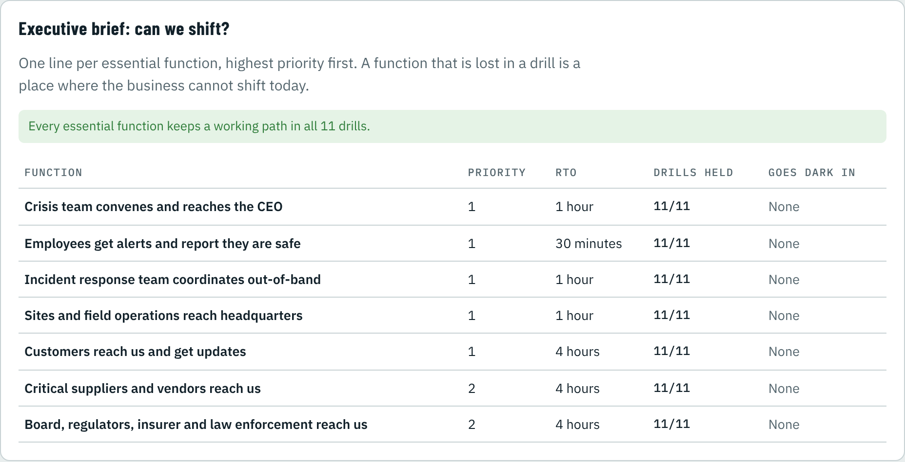
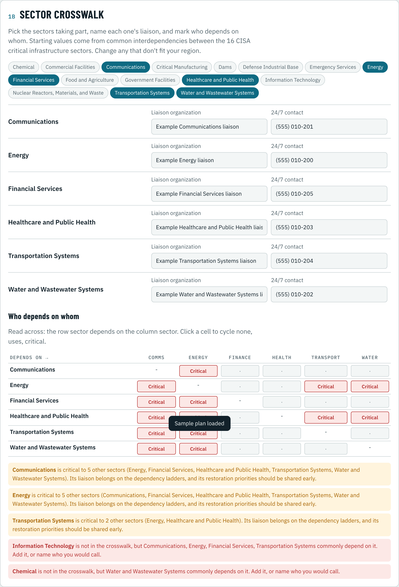

# PACE Snap for Business Continuity

Build a PACE communications plan that keeps your company able to **shift when problems arise**: a hurricane, a ransomware attack, a carrier or cloud outage, a building you cannot get into. It sets out how people reach each other, in what order to try, and **when someone is listening**, from the frontline worker up to the CEO, the sector and the partners across sectors. It runs in your browser, needs no account, and keeps your data on your device.

**Try it:** https://jdlee77.github.io/pacesnap_corperate/


## What it is

PACE (Primary, Alternate, Contingency, Emergency) is a method for deciding in advance what you switch to when a communications path fails. PACE Snap turns that into a planning tool for five levels:

| Level | For | What it answers |
| --- | --- | --- |
| **Frontline** | An employee, shift lead or field technician | How does my manager reach me? How do I check in safe and ask for what I need to keep working? |
| **Site** | A store, plant, branch, warehouse, clinic or crew | How does the incident team reach site leaders, how do leaders reach the shift, and how does the site get resources? |
| **Company** | The CEO, crisis management team and BC lead | Can the crisis team convene, can we alert and account for employees, and can customers, suppliers and regulators reach us, even when our own systems are compromised? |
| **Sector** | An ISAC, sector coordinating council, mutual-assistance group or industry association | How do member companies, government partners and neighboring sectors reach us when member systems are down? |
| **Crosswalk** | A business EOC, regional public-private partnership or group of lifeline sectors | Who depends on whom across sectors, and how do sectors and government reach each other when one of them fails? |

## Built for the corporate threat picture

- **Your company login is a single point of failure.** Email, chat, the HR app and the corporate network all depend on it. The ransomware drill takes them all out at once, and the builder looks for rungs that survive, such as an out-of-band crisis platform with no company login, a dial-in bridge, or mobile phones.
- **"Cyber incident declared" is a trigger.** Out-of-band channels can be set to switch on when a cyber incident is declared, as well as when the plan is activated or when the rungs above stop answering.
- **Third-party services still need a phone network.** Mass notification, the employee hotline and the conference bridge are hosted elsewhere, but they fail when every phone network is down, as in a hurricane.
- **Drills that match business risk:** carrier core outage, ransomware, major cloud outage, 72 hours with no grid, building closed, shelter in place, a holiday weekend at 02:00, key people unavailable, a notification-vendor outage, fuel running out, hurricane landfall, and (for sectors) government portal loss, geomagnetic storm and cascading lifeline failure.

## What a CEO gets



- **Executive brief.** One line per essential function, with its priority, RTO, drills held, and where it goes dark today.
- **Activation authority.** Who can activate the plan is printed on the shared plan.
- **Standards crosswalk.** Shows where the plan gives evidence for ISO 22301 (§8.4.3, §8.5), NFPA 1600/1660, NIST CSF 2.0 (RS.CO, RC.CO), the FFIEC BCM booklet, SEC Form 8-K Item 1.05, NIPP 2013 and FEMA Community Lifelines. Each row is live: it is supported when the readiness gates it relies on pass. It is a planning aid, not a compliance determination.
- **Executive sign-off** as a readiness gate.

## Sector and crosswalk plans



- **Sector plans** pick one of the 16 CISA critical infrastructure sectors and get a suggested function for that sector (for example, Energy: "Mutual-assistance crews and staging areas reach us").
- **Crosswalk plans** pick the participating sectors, name a liaison and a 24/7 contact for each, and fill in a dependency grid (none / uses / critical). It starts from common interdependencies. The tool shows which sectors are hubs (Energy and Communications, usually), and flags sectors that others depend on but that are not at the table.

## Working with public safety

This app is the private-sector companion to [PACE Snap for public safety](https://jdlee77.github.io/pacesnap/). The two plan the same thing from opposite sides: an agency plans how the public and partners reach it, and a company plans how its people, partners and responders reach it. They meet in a two-way exchange:

| Direction | From | To | What travels |
| --- | --- | --- | --- |
| Company → public safety | **Public safety contact sheet** (this app) | 911 center, emergency management, fusion center, an agency's PACE Snap plan | 24/7, non-public numbers that reach a staffed desk, in PACE order, plus who answers, how callers are verified, what the company can do, and site notes |
| Public safety → company | **Shared plan PDF** (public safety app) | The company's Sector or Crosswalk plan, as a reach-out point or EOC liaison contact | How to reach the agency, county or state EOC when the usual paths fail |

### Public safety contact sheet

Site, Company, Sector and Crosswalk plans each have a ladder for public safety (for example "Public safety reaches us (24/7, not public)"). Section 6 turns it into a sheet for responders and checks it before you share it:

- **Staffed 24/7.** Every rung must be monitored around the clock. Business-hours or triggered rungs are flagged.
- **Not public.** A number or address that also appears on a public-facing ladder (customers, public messaging) or in the backup methods is flagged, because it is no longer private.
- **Useful.** It says who answers and what they can authorize, how you verify that a caller really is public safety, and what you can do for responders (site access, hazmat inventory, shutoffs, facility status, staff accountability, resources to offer, cyber coordination, video).
- **Locations** (optional): an on-site 24/7 contact and notes to read before arrival, such as a Knox box or ammonia refrigeration. Gate and alarm codes stay off the sheet and are given by phone after you verify the caller.

Three exports, all marked for public safety use only, with a review-by date 90 days out:

- **Responder contact sheet (PDF)**: one page, for the 911 center and the EOC.
- **Phone contacts (.vcf)**: loads straight into a responder's or duty officer's phone, with each number labeled P, A, C or E.
- **Dispatch / EOC import (CSV)**: schema `pace-snap-responder-1`, one row per rung and per location, for dispatch premise files and EOC private-sector directories. Agencies using PACE Snap for public safety import it directly into the **Private-sector partners** section of an Agency, State or Region plan, which flags drafts and overdue sheets and exports a combined partner directory.

Until every check passes, the exports are marked Draft.

## How it works

1. **Reasons to reach you.** Keep or edit the functions. Each gets its own ladder. Company, Sector and Crosswalk plans add a priority and an RTO (take them from your business impact analysis).
2. **Your kit.** Check only what you really have. It always starts empty. Add your own items to any module.
3. **The plan builds itself.** Each function gets a P-A-C-E ladder on four distinct failure paths, with a plain-language reason for every rung. You can override any rung.
4. **Contacts and listening.** How others reach you, who answers, and when each method is monitored: always, business hours, on a schedule, or when triggered.
5. **Drills and gates.** Outage drills show where the plan breaks. Readiness gates check Feasible, Acceptable, Suitable, Distinguishable and Complete (the CISA/NCSWIC criteria), plus Monitored, survival of every drill, and gates specific to each level.
6. **Share.** A shared plan PDF to hand out, a planning report PDF for your files and your auditors, a CSV for rolling plans up across sites or members, and a save file.

First-time visitors get an 11-step guided setup that builds their **Frontline** plan while teaching the method. **Load sample plan** shows a finished plan at any level.

## Privacy

Everything is stored in your browser's local storage. There is no server and no analytics. Exports can contain contact details, so share them with care. The CSV leaves out contact numbers, names and liaison details unless you tick the box.

## Run it locally

It is a single HTML file with no build step.

```bash
git clone https://github.com/jdlee77/pacesnap_corperate
```

```bash
cd pacesnap_corperate && python3 -m http.server 8000
```

Then open http://localhost:8000. The first PDF export loads jsPDF and jsPDF-AutoTable from cdnjs, and the page loads its fonts from Google Fonts, so it needs internet at least once.

## Using the exports

- **Download shared plan** gives the PDF to hand to other people.
- **Planning report** adds the executive brief, gates, standards crosswalk, sector crosswalk, drills and reasoning.
- **Public safety contact sheet** exports a PDF, a .vcf and a `pace-snap-responder-1` CSV of the 24/7 non-public numbers (see above).
- **Export CSV** writes one row per rung (schema `pace-snap-biz-csv-1`) plus crosswalk liaison rows, so plans can be combined in a spreadsheet.
- **Save progress** writes a `.json` file with all five levels. **Load progress** restores it.

## Limits and assumptions

- The asset ratings, failure paths, drills, default monitoring, sector interdependencies and standards mappings are working assumptions. Practitioners need to review them before anyone relies on them. See [docs/DESIGN.md](docs/DESIGN.md) for the open questions.
- PACE Snap checks a plan on paper. It does not replace testing: make a real two-way contact on each rung.
- This is an independent project. It is not an official CISA, FEMA, NCSWIC, ISO, NFPA, NIST, FFIEC or SEC product.

## Background

PACE is a method that comes from the military. The plan criteria follow NCSWIC PACE guidance (2023) and the CISA criteria for communications plans, adapted here for business continuity. This repository is the corporate edition of PACE Snap, which was built for public safety.

## License

MIT. See [LICENSE](LICENSE).
